# Tachyon R2

Store WordPress images in [Cloudflare R2](https://developers.cloudflare.com/r2/) so the [Tachyon Edge](https://github.com/soderlind/tachyon-edge) Worker can serve and resize them.

[Tachyon Edge Images](https://github.com/soderlind/tachyon-edge-images) and [tachyon-plugin](https://github.com/humanmade/tachyon-plugin) only rewrite image URLs. They never upload files. Tachyon R2 fills that gap: it puts each uploaded image in the bucket the Worker reads from, at the key the Worker expects.

<a href="https://raw.githubusercontent.com/soderlind/tachyon-r2/main/docs/diagrams/out/overview-light.svg">
<picture>
  <source media="(prefers-color-scheme: dark)" srcset="docs/diagrams/out/overview-dark.svg">
  
</picture>
</a>

How each upload method works, how existing images are copied, and the diagram sources are in [Upload methods](#upload-methods), [Existing images](#existing-images) and [docs/diagrams](docs/diagrams).

Diagrams created with [Illustrate Design](https://github.com/soderlind/skills#illustrate-design).

## Requirements

- WordPress 7.0+, PHP 8.3+
- A Tachyon plugin that rewrites image URLs: [Tachyon Edge Images](https://github.com/soderlind/tachyon-edge-images) or [tachyon-plugin](https://github.com/humanmade/tachyon-plugin). Without one, Tachyon R2 runs in sync mode only.
- An R2 bucket and an [R2 API token](https://developers.cloudflare.com/r2/api/tokens/) with *Object Read & Write* on that bucket
- For offload, stream and skip-thumbnails: `TACHYON_URL` defined

## Install

1. Install and activate [Tachyon Edge Images](https://github.com/soderlind/tachyon-edge-images) or [tachyon-plugin](https://github.com/humanmade/tachyon-plugin). If you network-activate Tachyon R2, network-activate the Tachyon plugin too.
2. Download `tachyon-r2.zip` from the [latest release](https://github.com/soderlind/tachyon-r2/releases) and upload it in **Plugins → Add New → Upload Plugin**.
3. Activate Tachyon R2. On multisite, where the settings live depends on how you activate it (see [Multisite](#multisite)).

## Configure

Use **Settings → Tachyon R2**, or constants in `wp-config.php`. A constant overrides the setting and locks the field. Use constants for the secret, so it isn't stored in the database.

```php
define( 'TACHYON_URL', 'https://tachyon-edge.example.workers.dev/uploads' );

define( 'TACHYON_R2_ACCOUNT_ID', '...' );
define( 'TACHYON_R2_ACCESS_KEY_ID', '...' );
define( 'TACHYON_R2_SECRET_ACCESS_KEY', '...' );
define( 'TACHYON_R2_BUCKET', 'tachyon-uploads' );
define( 'TACHYON_R2_MODE', 'offload' );        // sync | offload | stream
define( 'TACHYON_R2_SKIP_THUMBNAILS', true );  // optional
// define( 'TACHYON_R2_KEY_PREFIX', 'uploads' ); // default: path of TACHYON_URL
// define( 'TACHYON_R2_ENDPOINT', 'https://<account>.eu.r2.cloudflarestorage.com' ); // jurisdictions
```

Check the connection with **Check connection** on the settings page, or `wp tachyon-r2 status`.

### Multisite

| Activation | Settings page | Settings apply to |
|---|---|---|
| Network Activate | **Network Admin → Settings → Tachyon R2** | every site |
| Activate on one site | that site's **Settings → Tachyon R2** | that site only |

On multisite only network administrators (`manage_network_options`) can change the settings. Constants apply to every site.

A site that was activated on its own before per-site settings existed keeps using the network settings until you save its own; the settings page says so. A site you activate now starts unconfigured.

### Object keys

Keys mirror the Tachyon URL path, so the Worker finds the object without any mapping:

| Upload | URL | R2 key |
|---|---|---|
| single site | `…/uploads/2026/01/photo.jpg` | `uploads/2026/01/photo.jpg` |
| multisite blog 3 | `…/uploads/sites/3/2026/01/photo.jpg` | `uploads/sites/3/2026/01/photo.jpg` |

The prefix (`uploads`) is the path of `TACHYON_URL`. If your Worker sets `TACHYON_KEY_PREFIX`, set the same prefix here.

## Upload methods

Only images the Worker serves (gif, jpg, jpeg, png, webp, avif) go to R2. PDFs, video and other files always stay local.

| Method | Local files | Needs `TACHYON_URL` | Notes |
|---|---|---|---|
| **sync** (default) | kept | no | Copies each image and its sizes to R2. Safe to turn off at any time. |
| **offload** | deleted after upload | yes | Files are written locally, uploaded, then removed at the end of the request. |
| **stream** | never written | yes | Uploads are written straight to R2 through a `tachyon-r2://` stream wrapper. |

Offload and stream need a Tachyon plugin (Tachyon Edge Images or tachyon-plugin) and `TACHYON_URL`. Without them, offload and stream fall back to sync, so images never become unreachable.

Offload mode (sync is the same without the final delete):

<a href="https://raw.githubusercontent.com/soderlind/tachyon-r2/main/docs/diagrams/out/offload-upload-view-light.svg">
<picture>
  <source media="(prefers-color-scheme: dark)" srcset="docs/diagrams/out/offload-upload-view-dark.svg">
  
</picture>
</a>

Stream mode:

<a href="https://raw.githubusercontent.com/soderlind/tachyon-r2/main/docs/diagrams/out/stream-upload-view-light.svg">
<picture>
  <source media="(prefers-color-scheme: dark)" srcset="docs/diagrams/out/stream-upload-view-dark.svg">
  
</picture>
</a>

**Skip thumbnails** stops WordPress from creating sub-size files. The sizes are still recorded in the attachment metadata, so `srcset`, `the_content` and the block editor work; Tachyon creates them on request.

When images may be missing locally (offload, stream or skip thumbnails), Tachyon R2 also:

- turns on Tachyon in the admin (`tachyon_disable_in_admin` → false) so the media library shows R2 images;
- stops Tachyon's REST edit-context override, so the block editor gets Tachyon URLs;
- returns Tachyon URLs from `wp_get_attachment_url()` for images that only exist in R2.

## Existing images

Images uploaded before the plugin was configured are not in R2 yet. When some are missing, the plugin shows a notice: **N existing images aren't in R2 yet**, with **Copy to R2** and **Not now** buttons.

The **Existing images** panel is on the settings page. When the plugin is network-activated, it is on each site's **Media → Tachyon R2** page. The panel:

- shows how many images are in R2 and how many are not;
- copies them in the background, newest first, in small WP-Cron batches. An open panel also processes batches, so it finishes faster;
- has Pause, Resume and Cancel. A cancelled or interrupted copy picks up where it stopped, because only images not yet in R2 are processed;
- lists failed images with the error. **Retry failed** runs them again;
- in offload or stream mode, can delete the local copies after upload. This is off by default, and an image's local files are deleted only when all of them reached R2.

<a href="https://raw.githubusercontent.com/soderlind/tachyon-r2/main/docs/diagrams/out/copy-existing-view-light.svg">
<picture>
  <source media="(prefers-color-scheme: dark)" srcset="docs/diagrams/out/copy-existing-view-dark.svg">
  
</picture>
</a>

Local files are kept unless you opt in, even in offload or stream mode. Change the batch size with the `tachyon_r2_backfill_batch_size` filter (default 20). For large libraries, or when WP-Cron is disabled, use `wp tachyon-r2 sync --all --keep-local`.

## WP-CLI

```bash
wp tachyon-r2 status                      # settings + connection check
wp tachyon-r2 sync --all [--dry-run]      # upload existing images
wp tachyon-r2 sync 12 13 [--keep-local]   # specific attachments
wp tachyon-r2 restore --all               # download images back to disk
```

`sync` moves an existing library to R2. In offload or stream mode it removes the local copies unless you pass `--keep-local`. `restore` brings files back before you switch to sync mode or deactivate the plugin.

On multisite, run each command per site with `--url=`.

## Abilities API

On WordPress 7.0+, Tachyon R2 registers the `tachyon-r2/get-status` and `tachyon-r2/get-backfill-status` read-only abilities. They are available through the WordPress Abilities REST API and, when the WordPress MCP Adapter is installed, as MCP tools. Both require the capability used to manage Tachyon R2 settings.

## Deleting

Deleting an attachment deletes its objects in R2. Uninstalling the plugin removes the settings and copy-job state only; objects in R2 are left alone.

## FAQ

### Why do my images still have local URLs?

Tachyon R2 copies images to R2 but doesn't change URLs; the Tachyon plugin (Tachyon Edge Images or tachyon-plugin) does. It only rewrites URLs when `TACHYON_URL` is defined. Until then the settings page shows **Tachyon: Not detected** and the plugin runs in sync mode. Images go to R2, but pages keep serving the local files. Define `TACHYON_URL` in `wp-config.php`. Image URLs then point at the Worker, which reads from R2.

### What should `TACHYON_URL` be?

Your Worker URL, plus a path only if your R2 keys start with one. The path becomes the key prefix. For multisite, tachyon-plugin strips `/sites/N` from the uploads URL, so keys keep it:

| `TACHYON_URL` | Image URL | R2 key |
|---|---|---|
| `https://tachyon-edge.<subdomain>.workers.dev` | `…/sites/68/2026/11/photo.jpg` | `sites/68/2026/11/photo.jpg` |
| `https://tachyon-edge.<subdomain>.workers.dev/uploads` | `…/uploads/sites/68/2026/11/photo.jpg` | `uploads/sites/68/2026/11/photo.jpg` |

To check, request a known image: `curl -I "<TACHYON_URL>/sites/68/2026/11/photo.jpg?w=100"` should return `200`.

### I uploaded images before setting `TACHYON_URL`. Do I have to upload them again?

Only if the key prefix changes. Before `TACHYON_URL` is defined the prefix is empty, so keys look like `sites/68/2026/11/photo.jpg`. If `TACHYON_URL` has no path, nothing changes. If it ends in `/uploads`, you have two options:

- Set `TACHYON_R2_KEY_PREFIX` to `''` to keep the old keys. The Worker's `TACHYON_KEY_PREFIX` must match.
- Or upload again under the new keys with `wp tachyon-r2 sync --all --keep-local`. The **Copy to R2** panel skips images already marked as in R2, so use the CLI.

### Does the bucket need to be public?

No. Visitors never fetch from R2 directly. The Tachyon Edge Worker reads the bucket through its binding and serves resized images.

## Limitations

- **Editor URLs.** When images may be remote, the block editor inserts Tachyon URLs into post content. They keep working, but they don't revert if you go back to sync.
- **`wp media regenerate`** needs the original locally. Run `wp tachyon-r2 restore` first for offloaded images.
- **Image editing** (crop, rotate) downloads the original to a temp file, then uploads the result.
- **Other plugins** that read files from disk (`get_attached_file()`), for example EXIF or optimisation plugins, won't find offloaded or streamed images.
- **Large files.** Uploads use a single `PUT`, which R2 limits to 5 GB.

## Development

```bash
composer install
composer test   # unit tests: SigV4 vectors, key mapping, stream wrapper
composer lint
```

## License

GPL-2.0-or-later. © Per Soderlind.
