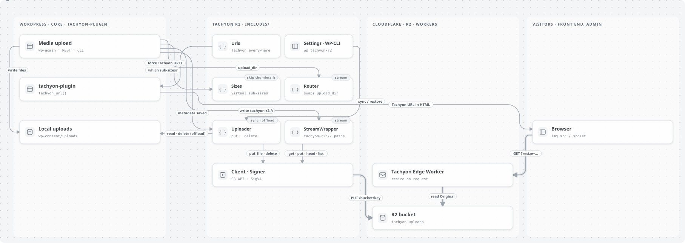

# Tachyon R2

Store WordPress images in [Cloudflare R2](https://developers.cloudflare.com/r2/) so the [Tachyon Edge](https://github.com/soderlind/tachyon-edge) Worker can serve and resize them.

[tachyon-plugin](https://github.com/humanmade/tachyon-plugin) only rewrites image URLs. It never uploads files. Tachyon R2 fills that gap: it puts each uploaded image in the bucket the Worker reads from, at the key the Worker expects.

<a href="https://raw.githubusercontent.com/soderlind/tachyon-r2/main/docs/diagrams/out/overview-light.svg">
<picture>
  <source media="(prefers-color-scheme: dark)" srcset="docs/diagrams/out/overview-dark.svg">
  
</picture>
</a>

How each upload method works, and the diagram sources, are in [Upload methods](#upload-methods) and [docs/diagrams](docs/diagrams).

## Requirements

- WordPress 6.5+, PHP 8.3+
- An R2 bucket and an [R2 API token](https://developers.cloudflare.com/r2/api/tokens/) with *Object Read & Write* on that bucket
- For offload, stream and skip-thumbnails: [tachyon-plugin](https://github.com/humanmade/tachyon-plugin) active and `TACHYON_URL` defined

## Install

1. Download `tachyon-r2.zip` from the [latest release](https://github.com/soderlind/tachyon-r2/releases) and upload it in **Plugins → Add New → Upload Plugin**.
2. Activate it. On multisite, the settings are network-wide (**Network Admin → Settings → Tachyon R2**).

## Configure

Use **Settings → Tachyon R2**, or constants in `wp-config.php`. A constant overrides the setting and locks the field. Use constants for the secret, so it isn't stored in the database.

```php
define( 'TACHYON_URL', 'https://tachyon-edge.example.workers.dev/uploads' );

define( 'TACHYON_R2_ACCOUNT_ID', '...' );
define( 'TACHYON_R2_ACCESS_KEY_ID', '...' );
define( 'TACHYON_R2_SECRET_ACCESS_KEY', '...' );
define( 'TACHYON_R2_BUCKET', 'tachyon-uploads' );
define( 'TACHYON_R2_MODE', 'offload' );        // sync | offload | stream
define( 'TACHYON_R2_SKIP_THUMBNAILS', true );  // optional
// define( 'TACHYON_R2_KEY_PREFIX', 'uploads' ); // default: path of TACHYON_URL
// define( 'TACHYON_R2_ENDPOINT', 'https://<account>.eu.r2.cloudflarestorage.com' ); // jurisdictions
```

Check the connection with **Check connection** on the settings page, or `wp tachyon-r2 status`.

### Object keys

Keys mirror the Tachyon URL path, so the Worker finds the object without any mapping:

| Upload | URL | R2 key |
|---|---|---|
| single site | `…/uploads/2026/01/photo.jpg` | `uploads/2026/01/photo.jpg` |
| multisite blog 3 | `…/uploads/sites/3/2026/01/photo.jpg` | `uploads/sites/3/2026/01/photo.jpg` |

The prefix (`uploads`) is the path of `TACHYON_URL`. If your Worker sets `TACHYON_KEY_PREFIX`, set the same prefix here.

## Upload methods

Only images the Worker serves (gif, jpg, jpeg, png, webp, avif) go to R2. PDFs, video and other files always stay local.

| Method | Local files | Needs Tachyon | Notes |
|---|---|---|---|
| **sync** (default) | kept | no | Copies each image and its sizes to R2. Safe to turn off at any time. |
| **offload** | deleted after upload | yes | Files are written locally, uploaded, then removed at the end of the request. |
| **stream** | never written | yes | Uploads are written straight to R2 through a `tachyon-r2://` stream wrapper. |

If Tachyon isn't detected, offload and stream fall back to sync, so images never become unreachable.

Offload mode (sync is the same without the final delete):

<a href="https://raw.githubusercontent.com/soderlind/tachyon-r2/main/docs/diagrams/out/offload-upload-view-light.svg">
<picture>
  <source media="(prefers-color-scheme: dark)" srcset="docs/diagrams/out/offload-upload-view-dark.svg">
  
</picture>
</a>

Stream mode:

<a href="https://raw.githubusercontent.com/soderlind/tachyon-r2/main/docs/diagrams/out/stream-upload-view-light.svg">
<picture>
  <source media="(prefers-color-scheme: dark)" srcset="docs/diagrams/out/stream-upload-view-dark.svg">
  
</picture>
</a>

**Skip thumbnails** stops WordPress from creating sub-size files. The sizes are still recorded in the attachment metadata, so `srcset`, `the_content` and the block editor work; Tachyon creates them on request.

When images may be missing locally (offload, stream or skip thumbnails), Tachyon R2 also:

- turns on Tachyon in the admin (`tachyon_disable_in_admin` → false) so the media library shows R2 images;
- stops Tachyon's REST edit-context override, so the block editor gets Tachyon URLs;
- returns Tachyon URLs from `wp_get_attachment_url()` for images that only exist in R2.

## WP-CLI

```bash
wp tachyon-r2 status                      # settings + connection check
wp tachyon-r2 sync --all [--dry-run]      # upload existing images
wp tachyon-r2 sync 12 13 [--keep-local]   # specific attachments
wp tachyon-r2 restore --all               # download images back to disk
```

`sync` moves an existing library to R2. In offload or stream mode it removes the local copies unless you pass `--keep-local`. `restore` brings files back before you switch to sync mode or deactivate the plugin.

On multisite, run each command per site with `--url=`.

## Deleting

Deleting an attachment deletes its objects in R2. Uninstalling the plugin removes the settings only; objects in R2 are left alone.

## Limitations

- **Editor URLs.** When images may be remote, the block editor inserts Tachyon URLs into post content. They keep working, but they don't revert if you go back to sync.
- **`wp media regenerate`** needs the original locally. Run `wp tachyon-r2 restore` first for offloaded images.
- **Image editing** (crop, rotate) downloads the original to a temp file, then uploads the result.
- **Other plugins** that read files from disk (`get_attached_file()`), for example EXIF or optimisation plugins, won't find offloaded or streamed images.
- **Large files.** Uploads use a single `PUT`, which R2 limits to 5 GB.

## Development

```bash
composer install
composer test   # unit tests: SigV4 vectors, key mapping, stream wrapper
composer lint
```

## License

GPL-2.0-or-later. © Per Soderlind.
